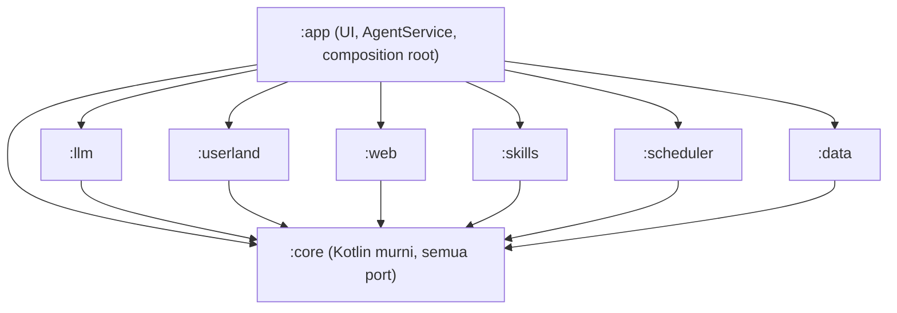
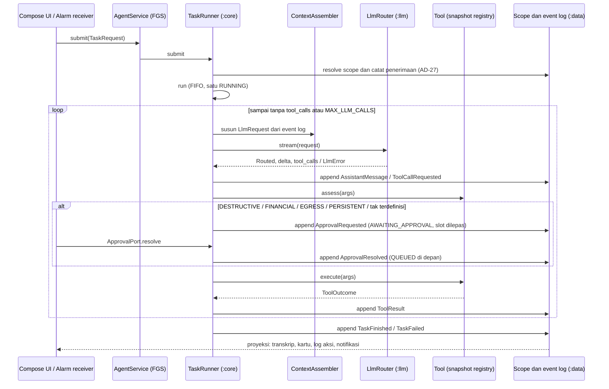
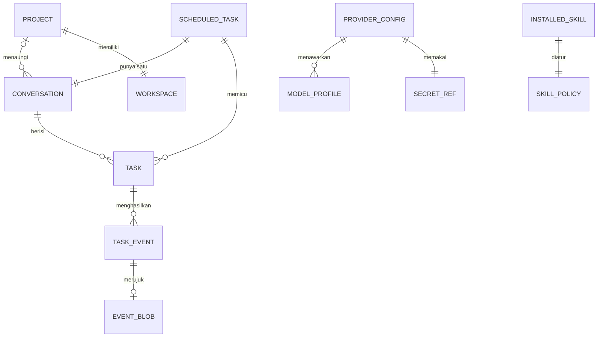
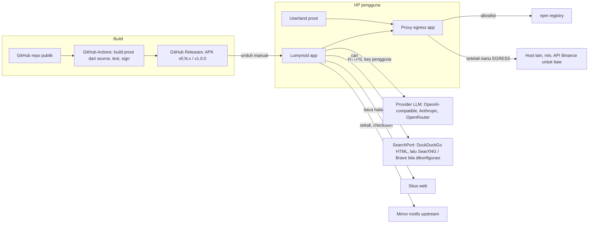

# Architecture Spine — Lumynoid v1

## Design Paradigm

**Hexagonal (ports & adapters).** Inti agent (`:core`) adalah Kotlin murni tanpa `android.*`. Semua yang menyentuh dunia luar (LLM, shell, web, skill, alarm, penyimpanan, UI) adalah adapter di sekeliling port yang dideklarasikan `:core`. Setiap eksekusi tugas menghasilkan **event log** yang ditulis oleh satu penulis (TaskRunner), dan semua tampilan adalah proyeksi baca dari log itu.

| Lapisan | Modul Gradle | Isi |
| --- | --- | --- |
| Domain + port | `:core` | TaskRunner, loop agent, ToolRegistry, gerbang konfirmasi, ContextAssembler, TaskEvent, semua interface port |
| Adapter keluar | `:llm`, `:userland`, `:web`, `:skills`, `:scheduler`, `:data` | Provider LLM + router, proot, cari/baca web, Agent Skills, alarm, Room + blob + secret store |
| Adapter masuk + host | `:app` | Compose UI, kartu, AgentService (FGS), receiver alarm/boot, composition root |



Panah berarti "boleh bergantung". Adapter tidak saling bergantung. Kebutuhan lintas adapter dipenuhi lewat port di `:core` dan dirakit di `:app`.

## Invariants & Rules

### AD-1 — Batas hexagonal ditegakkan oleh modul

- **Binds:** all
- **Prevents:** loop agent tercampur Compose/Service sehingga epic 3 dan 4 harus mengubah loop epic 2; adapter saling memanggil langsung.
- **Rule:** `:core` tidak mengimpor `android.*`, `androidx.*`, Ktor, atau Room, dan diuji di JVM. Adapter hanya bergantung ke `:core`. Hanya `:app` yang merakit adapter, lewat composition root manual tanpa framework DI. Menambah dependensi di luar grafik di atas berarti mengubah spine.

### AD-2 — Satu jalur eksekusi: TaskRunner di AgentService

- **Binds:** R3, R4, R6, R13, C5, epic-chat-dan-provider, epic-agent-shell, epic-projects, epic-tugas-terjadwal
- **Prevents:** epic 1 membangun jalur chat terpisah yang lalu dibongkar epic 2; scheduler memanggil LLM sendiri; UI memegang loop yang mati saat layar ditutup.
- **Rule:**
  - Setiap giliran LLM (chat polos, tugas agent, tugas terjadwal) masuk lewat `TaskRunner.submit`. Sampai Epic 2, `TaskRequest` membawa `workspaceId`; sejak Projects, pemanggil hanya menentukan percakapan, dan runner memperoleh scope workspace dari AD-27.
  - TaskRunner di-host `AgentService` (FGS `specialUse`) yang berjalan di proses utama app. Service ini naik ke foreground dan memegang partial wake lock selama ada tugas `RUNNING`, lalu berhenti saat tidak ada.
  - UI dan scheduler tidak pernah memanggil `LlmPort`. Satu-satunya pengecualian adalah `ProviderAdminPort` (AD-23).
  - epic-chat-dan-provider membangun kerangka TaskRunner dan AgentService tanpa tool; epic-agent-shell menambah tool dan gerbang ke kerangka yang sama.

### AD-3 — Satu tugas berjalan sekaligus

- **Binds:** R4, R6, R7, C6, epic-agent-shell, epic-tugas-terjadwal
- **Prevents:** dua userland atau node berjalan paralel dan menabrak phantom process killer (32 child) serta batas memori Android 17; dua tugas menulis workspace yang sama.
- **Rule:** Maksimal satu tugas berstatus `RUNNING`, dengan antrean FIFO. Status tugas: `QUEUED → RUNNING → (AWAITING_APPROVAL ↔ QUEUED) → FINISHED | FAILED | CANCELLED`. Status `AWAITING_APPROVAL` tidak memegang slot (AD-22). Tidak ada jalur eksekusi paralel.

### AD-4 — Event log single-writer adalah sumber kebenaran tugas

- **Binds:** R3, R4, R6, R8, R9, R11, semua epic
- **Prevents:** hasil tugas terjadwal ditulis ke percakapan dengan bentuk berbeda; log aksi menyimpang dari kartu.
- **Rule:**
  - Eksekusi menghasilkan `TaskEvent` bertipe yang di-append **hanya oleh TaskRunner**.
  - Transkrip, kartu aktivitas, kartu konfirmasi, log aksi (R9), dan notifikasi hasil adalah proyeksi baca dari event log.
  - Event bersifat append-only. Kode agent tidak pernah mengubah atau menghapusnya. Pengguna dapat menghapus percakapan beserta event dan blob-nya. Hingga Projects diterapkan, workspace milik percakapan ikut terhapus; setelahnya penghapusan workspace mengikuti AD-27.
  - Delta streaming tidak dipersist (hot `StateFlow`); event persisten adalah batas tahan-crash.
  - Status provider dan kuota bukan bagian dari event log (AD-23).

### AD-5 — Satu pemilik tulis per entitas

- **Binds:** all
- **Prevents:** dua epic menulis tabel yang sama, mis. scheduler dan runner sama-sama menulis percakapan.
- **Rule:** Hanya pemilik yang memanggil operasi tulis port repositori entitasnya (AD-19). Modul lain membaca lewat port baca.

| Entitas | Pemilik tulis (modul / epic) |
| --- | --- |
| Conversation, Task, TaskEvent, EventBlob | `:core` TaskRunner + ConversationPort / epic-agent-shell (skema awal epic-chat-dan-provider) |
| Project, instruksi, status penghapusan | `:core` ProjectPort / implementasi `:data` / epic-projects |
| Keanggotaan Conversation pada Project | `:core` ConversationPort / implementasi `:data` / epic-projects |
| ProviderConfig, ModelProfile | `:llm` / epic-chat-dan-provider |
| Secret | `SecretPort` (impl `:data`) / epic-chat-dan-provider |
| RouterState (rotasi, cooldown, sisa kuota) | `:llm` LlmRouter / epic-hemat-kuota |
| ScheduledTask | `:scheduler` / epic-tugas-terjadwal |
| InstalledSkill, SkillPolicy | `:skills` / epic-skill-pihak-ketiga |
| Rootfs, workspace, data skill di userland | `:userland` / epic-agent-shell |

### AD-6 — Kontrak tool dan registry

- **Binds:** R4, R5, R6, R7, epic-agent-shell, epic-browsing-web, epic-skill-pihak-ketiga, epic-tugas-terjadwal
- **Prevents:** tiap epic mengekspos tool ke LLM dengan caranya sendiri; nama tool ditolak provider; daftar tool berubah di tengah tugas.
- **Rule:**
  - Setiap tool mengimplementasikan `Tool { name; description; inputSchema: JsonObject; assess(args): RiskAssessment; describe(args): UiText; suspend execute(args, ctx): ToolOutcome }`.
  - Nama tool cocok dengan `^[a-z][a-z0-9_]{0,63}$` dan memakai prefiks pemilik: `shell_`, `web_`, `skill_`, `schedule_`.
  - Adapter mendaftarkan tool lewat `ToolProvider`. Registry adalah satu-satunya sumber daftar tool di `LlmRequest`.
  - TaskRunner mengambil snapshot registry saat tugas mulai dan memakainya sampai tugas selesai. Tugas berorigin `SCHEDULED` tidak mendapat tool `schedule_*`.
  - `ToolOutcome` membawa output penuh, metadata kartu (target, exit code, path artefak, sumber URL), dan `truncationHint`. Tool tidak memotong outputnya sendiri.

### AD-7 — Gerbang konfirmasi milik runner, default-deny

- **Binds:** R7, R8, R10, epic-agent-shell, epic-browsing-web, epic-skill-pihak-ketiga, epic-tugas-terjadwal
- **Prevents:** tool yang lupa meminta konfirmasi; LLM atau output tool mengklaim aksinya aman; tugas terjadwal mengeksekusi aksi berisiko tanpa pengguna; injeksi menanam tugas permanen.
- **Rule:**
  - Sebelum `execute`, runner memanggil `tool.assess(args)`. Penilaian ini kode deterministik yang hanya membaca args dan state app, tidak pernah klaim LLM.
  - `RiskClass ∈ {READ_ONLY, LOCAL_WRITE, DESTRUCTIVE, FINANCIAL, EGRESS, PERSISTENT}`, plus putusan `DENIED`.
  - Empat kelas terakhir (`DESTRUCTIVE`, `FINANCIAL`, `EGRESS`, `PERSISTENT`) memancarkan `ApprovalRequested`, dan tugas masuk `AWAITING_APPROVAL` (AD-22) sampai `ApprovalResolved` datang dari kartu app.
  - Args yang tidak bisa dinilai diperlakukan butuh konfirmasi. Heuristik berbasis teks (mis. teks perintah) hanya boleh menaikkan kelas risiko, tidak pernah menurunkannya.
  - Persetujuan berlaku per panggilan; v1 tidak punya "selalu izinkan".
  - Setiap approval kedaluwarsa setelah `APPROVAL_TTL = 12 jam`, lalu tugas berakhir `TaskFailed(APPROVAL_EXPIRED)`.
  - `schedule_create` dan `schedule_update` berkelas `PERSISTENT`; kartunya menampilkan teks input tugas secara penuh.

### AD-8 — Konten tool dan web adalah data

- **Binds:** R5, R7, R10
- **Prevents:** instruksi di halaman web atau output tool diperlakukan sebagai perintah.
- **Rule:** Output tool, isi halaman, dan output skill masuk konteks hanya sebagai pesan role `tool` dengan penanda asal. Runner bertindak hanya atas `tool_calls` terstruktur dari LLM dan tidak pernah mem-parse teks output untuk mencari instruksi.

### AD-9 — Jalur egress lewat URL dan tampilan ditutup

- **Binds:** R5, R8, R10, epic-browsing-web, epic-chat-dan-provider
- **Prevents:** eksfiltrasi data lewat URL buatan injeksi, redirect, atau render markdown.
- **Rule:**
  - `web_read` dinilai `READ_ONLY` hanya untuk URL yang **persis sama** dengan URL yang diketik pengguna atau yang dikembalikan `web_search` dalam tugas yang sama. URL lain, termasuk tautan yang ditemukan di dalam halaman, dinilai `EGRESS`.
  - Setiap hop redirect dinilai ulang dengan aturan yang sama.
  - Markdown asisten tidak me-render HTML mentah dan tidak mengambil gambar remote otomatis; gambar remote tampil sebagai tautan.
  - Setiap tautan keluar yang diketuk pengguna dibuka lewat dialog app yang menampilkan URL penuh.
  - Teks query `web_search` dikirim hanya ke backend pencarian yang dikonfigurasi.

### AD-10 — Kartu hanya dari event bertipe

- **Binds:** R4, R8, R9, R11, C2, C9
- **Prevents:** teks LLM tampil menyerupai kartu konfirmasi/aktivitas; persetujuan diberikan di luar kartu; judul kartu lama rusak setelah update APK; halaman web atau app lain membuka kartu approval.
- **Rule:**
  - `ActivityCard`, `ApprovalCard`, dan `PreviewCard` adalah komponen Compose yang dirender hanya dari `TaskEvent` bertipe. Teks LLM hanya muncul di bubble markdown, yang tidak bisa menghasilkan komponen kartu.
  - Judul kartu berasal dari `tool.describe(args)`, yaitu kalimat awam dari `strings.xml`. Perintah mentah dan nilai args tampil sebagai field data berlabel di bagian detail yang bisa dibuka.
  - `UiText` di `:core` adalah `UiText(key: String, args: Map<String, UiArg>)` dengan `key` stabil (mis. `card.shell.exec`). Event menyimpan `key` + args, tidak pernah teks jadi atau id `R`. Judul kartu dan notifikasi di-resolve saat render oleh satu registry di `:app`; key yang tidak dikenal tampil sebagai judul generik plus field data mentah, tidak pernah crash.
  - Notifikasi tidak membawa tombol setujui atau tolak; notifikasi hanya membuka kartu di app lewat deep-link.
  - Deep-link berarti `PendingIntent` eksplisit (`FLAG_IMMUTABLE`) ke satu activity `:app` dengan target bertipe `{taskId, eventId}`, dibuat oleh satu helper di `:app`. v1 tidak mendaftarkan intent-filter skema kustom atau http yang diekspor.

### AD-11 — Port LLM dengan model pesan dan error milik sendiri

- **Binds:** R2, R3, R12, C11, epic-chat-dan-provider, epic-hemat-kuota
- **Prevents:** tipe vendor bocor ke `:core`; tiap adapter menangani limit dan tool call rusak dengan caranya sendiri.
- **Rule:**
  - Antarmukanya `LlmPort.stream(LlmRequest): Flow<LlmChunk>`. Varian `LlmChunk` adalah `Routed(providerId, modelId)`, `TextDelta`, `ToolCallDelta`, `Usage`, dan `Done`.
  - Model pesan internal: `system | user | assistant | tool`, dengan `ToolCall{id, name, argsJson}`. Id ToolCall dibuat runner, dan adapter memetakannya ke id vendor per request.
  - Ada dua adapter wire, OpenAI Chat Completions-compatible dan Anthropic Messages, yang ditulis langsung di atas Ktor + kotlinx.serialization tanpa SDK vendor atau framework agent.
  - Kegagalan dinormalisasi ke `LlmError {RateLimited(retryAfter), QuotaExhausted, AuthFailed, ToolsUnsupported, MalformedToolCall, Network, Server}`. Tool call kosong dan args yang tidak bisa di-parse adalah `MalformedToolCall`.

### AD-12 — Rotasi dan filter model sebagai decorator LlmPort

- **Binds:** R12, epic-chat-dan-provider, epic-hemat-kuota
- **Prevents:** logika rotasi masuk ke loop agent atau layar chat; provider berganti di tengah jawaban.
- **Rule:**
  - `LlmRouter` di `:llm` mengimplementasikan `LlmPort` dan membungkus adapter provider. epic-chat-dan-provider mengirim router pass-through untuk satu provider.
  - epic-hemat-kuota mengisi rotasi, filter `ModelProfile.supportsTools` untuk request yang membawa tool, dan pembaruan `RouterState`, tanpa menyentuh TaskRunner.
  - Router hanya boleh berpindah provider sebelum `TextDelta`/`ToolCallDelta` pertama keluar, lalu mengumumkan pilihannya lewat `LlmChunk.Routed`. Runner mencatatnya sebagai `TaskEvent.ProviderSwitched`.

### AD-13 — Penyusunan konteks lewat contributor

- **Binds:** R5, R7, R9, R12, R13, epic-agent-shell, epic-projects, epic-hemat-kuota, epic-browsing-web, epic-skill-pihak-ketiga
- **Prevents:** epic 5 dan 6 memotong atau menyisipkan konteks dengan caranya sendiri; pemangkasan memisahkan pasangan tool call/result sehingga provider menolak request; log aksi ikut terpangkas.
- **Rule:**
  - `ContextAssembler` di `:core` menyusun setiap `LlmRequest` dari event log percakapan tugas. Versi awal dibuat di Story 1.7; Epic Projects menambah instruksi proyek ke jalur itu tanpa menunggu pemangkasan (AD-27).
  - Epic Hemat Kuota memiliki pemangkasan dan memperkenalkan `ContextContributor` dengan dua kelas:
    - `Pinned`: system prompt, instruksi skill aktif (AD-21), dan instruksi proyek setelah AD-27. Tidak dipangkas, tetapi dibatasi budget.
    - `Trimmable`: riwayat dan output tool, dipangkas menurut `TruncationPolicy` per `truncationHint`.
  - Unit pemangkasan adalah giliran utuh: `AssistantMessage` beserta semua `ToolCallRequested` dan `ToolResult` pasangannya.
  - Pemangkasan hanya berlaku untuk konteks; event log selalu menyimpan output penuh.

### AD-14 — Siklus hidup userland terikat tugas

- **Binds:** R4, R7, R11, C6, C7, C8, epic-agent-shell, epic-skill-pihak-ketiga
- **Prevents:** proses Linux hidup di luar tugas; tiap epic memanggil proot dengan caranya sendiri; pelanggaran W^X.
- **Rule:**
  - Semua eksekusi Linux lewat `Userland.exec(profile, cmd, cwd, env, timeout)` di `:userland`.
  - Binary proot dan loader dikirim sebagai `.so` di `jniLibs/arm64-v8a`, diekstrak saat instal (`useLegacyPackaging = true`), lalu dieksekusi dari `nativeLibraryDir`. Binary di rootfs hanya berjalan lewat loader proot. Tidak ada `execve` langsung terhadap file di direktori yang bisa ditulis app.
  - Rootfs diunduh saat pertama dipakai ke folder berversi di `filesDir` dan diverifikasi dengan checksum yang tertanam di build.
  - Userland dinyalakan lazy saat tool shell pertama dalam tugas. Saat tugas selesai, gagal, dibatalkan, atau masuk `AWAITING_APPROVAL`, userland dimatikan beserta semua proses anaknya.

### AD-15 — Secret tidak pernah keluar dari konsumennya

- **Binds:** R1, R2, R7, C1
- **Prevents:** API key atau kredensial skill bocor ke event log, konteks LLM, shell, atau backup.
- **Rule:**
  - API key dan key backend pencarian disimpan lewat `SecretPort`: dideklarasikan di `:core`, diimplementasikan di `:data` dengan AES-GCM memakai kunci Android Keystore yang non-exportable, dan disimpan terpisah dari Room.
  - Modul lain hanya memegang `SecretRef`. Yang boleh mendekripsi hanya `:llm` dan `:web`.
  - Secret tidak pernah masuk `TaskEvent`, log, konteks LLM, atau env userland.
  - Kredensial skill (mis. sesi `baw`) hanya ada di folder data skill itu, yang hanya di-mount pada profil `SKILL(id)` (AD-20).

### AD-16 — Penjadwalan lewat SchedulerPort, eksekusi lewat TaskRunner

- **Binds:** R6, epic-tugas-terjadwal
- **Prevents:** tugas dari chat dan dari layar disimpan dengan bentuk berbeda; scheduler mengubah loop; alarm hilang setelah update atau saat izin dicabut; run ganda.
- **Rule:**
  - Tugas terjadwal dibuat hanya lewat `SchedulerPort.create()`, baik dari layar maupun dari tool `schedule_create` (berkelas `PERSISTENT`).
  - `ScheduledTask.schedule` adalah sealed `Once | Daily | Weekly` dalam waktu lokal + `zoneId`. Setiap tugas terjadwal memiliki percakapan hasil khusus. Dari chat proyek, percakapan hasil menjadi anggota proyek asal; dari chat biasa tetap tanpa proyek. Untuk jadwal yang dibuat dari layar, proyek ditentukan oleh pilihan pengguna atau tidak ada. Workspace selalu di-resolve lewat AD-27.
  - Alurnya: exact alarm → receiver → `AgentService` → `TaskRunner.submit(origin = SCHEDULED(scheduleId), runKey = scheduleId + fireTime)`. `runKey` yang sama tidak pernah dieksekusi dua kali.
  - Alarm berikutnya dihitung saat fire. Alarm dipasang ulang pada `BOOT_COMPLETED`, `MY_PACKAGE_REPLACED`, `TIME_SET`, `TIMEZONE_CHANGED`, dan `SCHEDULE_EXACT_ALARM_PERMISSION_STATE_CHANGED`.
  - Jadwal yang terlewat (HP mati, alarm terlambat) mendapat paling banyak satu run susulan.
  - Epic Tugas Terjadwal menghapus jadwal proyek dan membatalkan alarmnya sebelum data proyek dibersihkan. Pembuatan jadwal dan pemasangan ulang alarm memakai gerbang lifecycle target (AD-27), sehingga tidak bisa lolos setelah penghapusan dimulai. Fire memeriksa jadwal masih ada dan target aktif saat runner menerima tugas. Percakapan hasil tidak bisa dihapus sendiri selama masih dirujuk jadwal.

### AD-17 — Dependensi bebas, tanpa layanan Google

- **Binds:** all, C1
- **Prevents:** satu epic menarik library non-free, layanan Google, atau binary prebuilt yang mengirim data ke pihak ketiga, melanggar kewajiban source GPL proot, atau masuk lewat dependensi transitif tanpa terlihat di PR.
- **Rule:**
  - Dilarang memakai Google Play Services, Firebase/FCM, ML Kit, analytics, atau crash reporter yang mengirim ke jaringan.
  - Hanya dependensi berlisensi OSI dari Maven Central atau Google Maven yang boleh dipakai. Kode native (proot, loader) dibangun dari source yang di-pin di CI, bukan di-commit sebagai prebuilt.
  - CI memeriksa classpath runtime rilis yang sudah di-resolve, termasuk transitif, dan gagal bila ada grup `com.google.android.gms`, `com.google.firebase`, `com.google.mlkit`, atau `com.google.android.play`, atau dependensi tanpa lisensi OSI. Stack di spine ini sudah lolos.
  - `.so` dari AAR Maven boleh bila berlisensi OSI, arm64-v8a, dan 16 KB-aligned (dicek CI).

### AD-18 — Preview adalah sandbox offline

- **Binds:** R11, R13, epic-agent-shell, epic-projects
- **Prevents:** HTML hasil kerja agent menjadi jalur egress atau membaca file di luar workspace.
- **Rule:**
  - WebView preview memuat file workspace hanya lewat `WebViewAssetLoader`, dengan `shouldInterceptRequest` deny-all untuk semua request lain dan `setBlockNetworkLoads(true)`.
  - Navigasi keluar diblok dan tidak pernah diserahkan ke app lain. Akses file dan content dimatikan, dan CSP yang melarang koneksi jaringan disuntikkan.
  - JavaScript mati secara default dan hanya dinyalakan pengguna per preview dari kartu.
  - Path di-resolve kanonik dan harus berada di dalam workspace; symlink yang keluar dari workspace ditolak. File non-HTML dipratinjau oleh viewer di dalam app.
  - Setelah Projects, setiap preview baru memverifikasi event artefak terhadap percakapan asal dan memperoleh workspace dari keanggotaan yang tersimpan. Workspace yang sudah tidak aktif atau tidak dapat di-resolve tidak boleh dibaca; ID workspace dari pemanggil tidak menjadi otoritas.

### AD-19 — Persistensi tunggal dengan migrasi wajib

- **Binds:** all, epic-chat-dan-provider, epic-tugas-terjadwal, epic-hemat-kuota, epic-skill-pihak-ketiga
- **Prevents:** pemilik di AD-5 tidak punya jalur tulis yang sah; epic 3 dan 4 yang berjalan paralel bertabrakan nomor versi DB; data pengguna hilang saat update antar-rilis epic; event lama atau baru tidak bisa dibaca; baris besar membuat proyeksi crash.
- **Rule:**
  - Hanya ada satu `RoomDatabase` di `:data`, di balik port repositori yang dideklarasikan `:core`.
  - `exportSchema` di-commit ke repo. Setiap kenaikan versi punya `Migration` eksplisit yang diuji dengan `MigrationTestHelper`. Destructive fallback dilarang di build release. CI menolak dua PR yang mengklaim nomor versi DB yang sama.
  - `TaskEvent` disimpan sebagai JSON bervesi. Subtipe yang tidak dikenal di-decode menjadi `TaskEvent.Unknown` dan tidak pernah membuat crash.
  - Payload event di atas 256 KB disimpan sebagai blob file milik `:data` (`EventBlobRef{id, size, sha256}`); event menyimpan referensinya plus potongan awal.

### AD-20 — Userland berprofil, jaringannya tertutup secara default

- **Binds:** R4, R7, R10, C8, epic-agent-shell, epic-skill-pihak-ketiga
- **Prevents:** shell menjangkau CLI atau kredensial skill tanpa kartu `FINANCIAL`; skrip (`node`, `postinstall` npm, `bash run.sh`) mengirim data keluar tanpa kartu `EGRESS`; tugas menulis ke `/opt/skills` bersama.
- **Rule:**
  - `Userland.exec` berjalan dengan salah satu dari dua profil:
    - `SHELL`: hanya me-mount rootfs (read-only untuk `/opt/skills`) dan `/workspace/<workspaceId>` milik tugas itu.
    - `SKILL(id)`: seperti `SHELL`, ditambah folder data skill tersebut.
  - Jaringan dari userland hanya lewat proxy di app dengan allowlist host (registry npm). Host lain baru terbuka untuk satu panggilan setelah kartu `EGRESS` disetujui.
  - Jika spike epic-agent-shell membuktikan proot tidak bisa memblok socket langsung, setiap perintah `shell_` yang menjalankan kode atau klien jaringan di luar allowlist dinilai `EGRESS`.

### AD-21 — Skill dipasang oleh pengguna dan dijalankan lewat kebijakannya

- **Binds:** R7, R8, R10, epic-skill-pihak-ketiga, epic-hemat-kuota, epic-agent-shell
- **Prevents:** agent memasang skill sendiri; instalasi berjalan di luar log dan di luar antrean; instruksi skill membengkak di konteks; `baw execute` dijalankan dengan args berbeda dari yang dipratinjau pengguna.
- **Rule:**
  - Skill hanya dipasang oleh pengguna dari layar app. Instalasi berjalan sebagai tugas tercatat dengan kartu instal buatan app, dan script npm mati kecuali disetujui di kartu itu.
  - Agent hanya memuat `SKILL.md` versi yang disetujui (dicatat dengan hash), sebagai konteks `Pinned` dalam budget per skill.
  - CLI skill hanya dijalankan lewat `skill_run(skill, argv)` dengan profil `SKILL(id)`. `SkillPolicy` memetakan argv ke `RiskClass` lewat `CommandPolicyPort` di `:core`, dan argv yang tidak dikenal butuh konfirmasi.
  - Perintah `FINANCIAL` yang punya pasangan preview (mis. `contract-call execute`) dinilai `DENIED` kecuali args-nya identik dengan preview sukses di tugas yang sama. Kartunya menampilkan ringkasan deterministik: aset, jumlah, tujuan, dan jaringan.

### AD-22 — Siklus approval dan pemulihan crash

- **Binds:** R6, R8, epic-agent-shell, epic-tugas-terjadwal
- **Prevents:** approval tugas terjadwal jam 03.00 memblok semua chat sampai pagi; FGS dan userland hidup berjam-jam menunggu; crash membuat transaksi dijalankan dua kali.
- **Rule:**
  - Menunggu approval adalah status `AWAITING_APPROVAL` yang tersimpan. Status ini melepas slot antrean dan mematikan userland, dan FGS berhenti bila tidak ada tugas `RUNNING`.
  - Begitu disetujui, tugas kembali `QUEUED` di depan antrean.
  - Saat app start, tugas yang belum punya event terminal ditutup dengan `TaskFailed(INTERRUPTED)`. ToolCall yang belum punya `ToolResult` tidak pernah dijalankan ulang otomatis.
  - `TaskRunner.cancel(taskId)` adalah satu-satunya jalur pembatalan.

### AD-23 — Port tulis bernama, asal pesan, dan sumber kuota

- **Binds:** R2, R3, R6, R12, epic-chat-dan-provider, epic-tugas-terjadwal, epic-hemat-kuota
- **Prevents:** layar pengaturan dan jadwal menulis langsung ke DB; tes koneksi melanggar AD-2; dua sumber angka kuota; teks buatan model diperlakukan sebagai pesan pengguna.
- **Rule:**
  - UI menulis hanya lewat port bernama: `TaskRunner.submit/cancel`, `ApprovalPort.resolve`, `ConversationPort` (buat, ubah nama, hapus), `SchedulerPort`, `ProviderAdminPort {save, testConnection, listModels, fetchQuota}`, `SkillInstallPort`, `SecretPort`, dan `ProjectPort` saat fitur Projects diterapkan (AD-27).
  - `UserMessage` mencatat origin: `USER` atau `SCHEDULE(scheduleId)`.
  - `RouterState`, yang diekspos `:llm` sebagai `Flow`, adalah satu-satunya sumber indikator kuota dan status provider.
  - `workspaceId` dan `conversationId` adalah identitas logis yang berbeda. Sebelum Projects, chat pengguna memakai nilainya yang sama; setelah Projects, scope workspace ditentukan oleh AD-27.

### AD-24 — Batas izin dan batas produk

- **Binds:** C2, C3, C13, all
- **Prevents:** sebuah epic menambah izin yang membuka kontrol app lain atau melanggar visi orang awam (C3); kode LGPL Operit tersalin masuk.
- **Rule:**
  - Izin manifest dibatasi allowlist: `INTERNET`, `FOREGROUND_SERVICE`, `FOREGROUND_SERVICE_SPECIAL_USE`, `POST_NOTIFICATIONS`, `SCHEDULE_EXACT_ALARM`, `RECEIVE_BOOT_COMPLETED`, `WAKE_LOCK`, `REQUEST_IGNORE_BATTERY_OPTIMIZATIONS`, dan `ACCESS_LOCAL_NETWORK` (diminta runtime hanya saat pengguna mengisi host LAN).
  - Dilarang: layanan Accessibility, `SYSTEM_ALERT_WINDOW`, `QUERY_ALL_PACKAGES`, Shizuku, dan MediaProjection.
  - UI tidak pernah menampilkan terminal interaktif.
  - Kode Operit tidak disalin; Operit hanya rujukan bacaan.

### AD-25 — Operasi, rilis, dan data di perangkat

- **Binds:** R1, C1, C7, C14, epic-chat-dan-provider, epic-agent-shell, epic-rilis-publik
- **Prevents:** APK ditolak HP saat verifikasi developer berlaku untuk unduhan langsung (rollout global 2027); update gagal karena kunci berbeda atau `versionCode` turun; kunci hilang sehingga update tidak bisa ditandatangani, atau bocor sehingga update palsu bisa dibuat; dua epic paralel merilis APK yang saling tidak bisa menimpa; riwayat dan secret ikut backup awan; update rootfs menghapus workspace atau skill; build debug menimpa build release di HP uji.
- **Rule:**
  - **Distribusi:** v1 hanya berupa APK bertanda tangan yang diunduh manual dari GitHub Releases (C14). App tidak punya pemeriksa atau pemasang update; pengguna memperbarui dengan mengunduh APK baru. Setiap rilis memuat tepat satu aset `lumynoid-<versionName>.apk` plus `SHA256SUMS`.
  - **Rilis:** APK rilis hanya dibangun dari tag di `main` oleh satu workflow rilis. CI menolak tag yang `versionCode`-nya tidak lebih besar dari rilis sebelumnya, atau yang skema Room-nya tidak berada di garis migrasi `main` (AD-19).
  - **Verifikasi developer:** pemilik proyek mendaftarkan `dev.lusalhi.lumynoid` dan fingerprint SHA-256 kunci rilis lewat Play Console dengan akun penuh, setelah mengecek ketersediaan nama, sebelum APK bertanda tangan pertama keluar. Pre-release `v0.x` dan artefak CI yang ditandatangani terhitung APK pertama.
  - **Kunci:** kunci rilis dibuat sekali secara offline. Salinan terenkripsi beserta passwordnya disimpan di dua lokasi di luar GitHub milik pemilik proyek, dan fingerprint SHA-256 sertifikatnya di-commit di repo dan README. Di CI, kunci hanya ada di GitHub Environment `release` yang terproteksi (hanya tag di `main`, persetujuan manual); workflow `pull_request` dan `pull_request_target` tidak pernah mengaksesnya. Penandatanganan di luar workflow rilis memakai `workflow_dispatch` di environment yang sama. v1 tidak merotasi kunci; bila kunci bocor, rotasi lewat lineage APK Signature Scheme v3 dan kunci baru didaftarkan sebelum APK pertama yang memakainya.
  - **Build dan uji:** `dependenciesInfo { includeInApk = false }`. Build debug memakai `applicationIdSuffix ".debug"`, hanya dipasang lewat `adb`, dengan debug keystore bersama yang di-commit. Pengujian di HP sungguhan memakai APK rilis (pre-release GitHub dari tag `main`).
  - **Backup:** `allowBackup="false"`, ditambah `dataExtractionRules` yang mengecualikan Room, blob, `filesDir`, dan secret store dari cloud backup maupun transfer antarperangkat.
  - **Rootfs dan data:** rootfs disimpan di folder berversi yang terpisah dari `workspace/` dan data skill. Setelah rootfs diganti, skill terpasang di-install ulang otomatis.
  - **Persetujuan unduhan:** unduhan rootfs dan unduhan npm pertama meminta persetujuan pengguna satu kali.
  - **Diagnostik:** crash ditangkap handler lokal tanpa jaringan, dengan secret dan isi prompt dibersihkan, lalu bisa diekspor pengguna lewat share sheet. Bila R8 aktif, `mapping.txt` tiap rilis dilampirkan ke rilis GitHub.

### AD-26 — Budget per tugas dan tool call rusak

- **Binds:** R12, C11, epic-agent-shell, epic-hemat-kuota
- **Prevents:** tugas berhenti diam-diam saat model gratis mengirim tool call kosong; satu tugas menghabiskan kuota harian; epic 2 dan 4 sama-sama atau tidak sama sekali menangani retry.
- **Rule:**
  - Runner menegakkan batas panggilan LLM per tugas: `MAX_LLM_CALLS`, default 20 dan bisa diatur pengguna. Tugas yang melewatinya berakhir `TaskFailed(BUDGET_EXHAUSTED)`.
  - Retry karena limit dan kuota menjadi milik router (AD-12).
  - Untuk `MalformedToolCall`, runner mengirim satu pesan perbaikan lalu mencoba lagi sekali. Jika masih rusak, tugas berakhir `TaskFailed(MALFORMED_TOOL_CALL)` yang terlihat pengguna. Event `LlmRetry` dan `ToolCallRejected` dicatat.

### AD-27 — Project memiliki workspace, percakapan memiliki riwayat

- **Binds:** R13, epic-projects, epic-tugas-terjadwal, epic-hemat-kuota, epic-rilis-publik. Berlaku mulai rilis Projects; Story 2.12 tetap memakai kontrak Epic 2.
- **Prevents:** chat kedua membuat workspace baru untuk proyek yang sama, mengirim riwayat chat lain ke provider, atau menghapus file bersama saat satu chat dihapus; jadwal atau kartu lama memakai workspace yang sudah dihapus.
- **Rule:**
  - Project memiliki ID workspace unik dan stabil; semua anggotanya berbagi file dan paket lokal di workspace itu. `ProjectPort` mengelola metadata, instruksi pengguna, dan penghapusan. `ConversationPort` menetapkan keanggotaan nol atau satu Project saat membuat chat atau mengadopsi data lama. Tidak ada pindah chat antarproyek. Metadata dan keanggotaan persisten di `:data`; operasi file tetap milik `:userland`.
  - Saat menerima tugas, `TaskRunner` memperoleh scope workspace dari keanggotaan tersimpan. Resume approval hanya melanjutkan scope yang sama dan masih aktif. Chat biasa tidak mendapat tool yang membutuhkan workspace. Scope hilang, invalid, atau sedang dihapus bukan chat biasa; tolak akses, jangan fallback ke ID percakapan.
  - Sebelum request pertama, runner mengambil satu snapshot instruksi proyek yang disunting pengguna, berlaku untuk semua request dan resume approval dalam tugas itu. Instruksi dibatasi saat disimpan; tidak menambah izin tool. Hanya riwayat dan hasil tool dari percakapan tugas masuk konteks. Isi file masuk setelah dibaca lewat tool, bukan otomatis. Epic Hemat Kuota memperlakukan snapshot instruksi sebagai `Pinned` (AD-13).
  - Penerimaan tugas, mutasi keanggotaan, dan penghapusan memakai satu gerbang serial: cek target aktif dan catat penerimaan tugas sebelum melepas gerbang, atau cek scope idle dan mulai penghapusan sebelum melepasnya. Jika penerimaan menang, penghapusan ditolak selama tugas sedang diterima, antre, berjalan, atau menunggu persetujuan; jika penghapusan menang, tolak penerimaan baru. Ini berlaku juga untuk hapus satu chat, yang hanya membersihkan data chat.
  - Setelah konfirmasi UI, `ProjectPort.delete` mencatat `DELETING` di dalam gerbang sebelum cleanup dan tidak menerima kerja, anggota, atau preview baru untuk proyek itu. Cleanup memakai pemilik di AD-5: `ConversationPort` untuk chat, event dan blob; `:userland` untuk workspace dan paket. Simpan identitas proyek dan workspace sampai pemilik menyelesaikan cleanup; baru hapus metadata proyek. Cleanup dapat diulang setelah interupsi. Rootfs dan provider tidak ikut dihapus.
  - Epic Projects tidak memerlukan `SchedulerPort`. Epic Tugas Terjadwal menambahkan pembatalan jadwal ke alur penghapusan dan pemeriksaan target lewat AD-16. Jangan menyelesaikan penghapusan proyek jika penonaktifan jadwal terkait gagal.
  - Upgrade dari APK Story 2.12 mempertahankan ID chat dan event, data tugas historis, serta blob per chat. Untuk setiap chat lama, periksa kedua root privat Epic 2 (`workspaces/<conversationId>` dan `coding-installs/<conversationId>`) tanpa membuat direktori. Jika ada data di salah satu root, buat tepat satu Project memakai `<conversationId>` sebagai ID workspace lama; file dan paket tidak dipindah atau disalin. Direktori kosong saja tidak membuat Project; kegagalan baca bukan bukti bahwa data tidak ada. Migrasi skema mengikuti AD-19. Adopsi filesystem berjalan di luar transaksi migrasi skema, persisten dan aman diulang, serta selesai sebelum task atau preview dipakai. Preview lama tetap memakai percakapan dan event asal (AD-18). APK Epic 2 belum memiliki jadwal untuk dimigrasikan.

## Consistency Conventions

| Concern | Convention |
| --- | --- |
| Package / application id | `dev.lusalhi.lumynoid`; package per modul `dev.lusalhi.lumynoid.<modul>` (`:app` = `dev.lusalhi.lumynoid.app`); debug `dev.lusalhi.lumynoid.debug` |
| Identitas manifest | Literal `dev.lusalhi.lumynoid` hanya di `applicationId` (`:app/build.gradle.kts`). Manifest memakai `${applicationId}`, kode memakai `context.packageName`. Satu `FileProvider` di `:app` dengan authority `${applicationId}.files` dan path hanya `cache/export/`. Alias Keystore tetap `lumynoid_secret_v1`, tidak diturunkan dari nama package |
| ID | UUIDv7 sebagai `String` untuk semua entitas |
| Waktu | Disimpan sebagai epoch millis UTC; jadwal memakai waktu lokal + `zoneId` (AD-16) |
| Serialisasi | kotlinx.serialization; sealed hierarchy dengan `classDiscriminator = "type"`; setiap subtipe yang dipersist wajib punya `@SerialName` snake_case eksplisit yang tidak pernah diubah, dicek CI |
| Error lintas port | Sealed result/error bertipe; exception tidak menyeberangi port kecuali `CancellationException` |
| Konkurensi | Port berbentuk `suspend`/`Flow`; dispatcher diinjeksi; pembatalan tugas = pembatalan coroutine + matikan userland |
| Logging | Tanpa secret dan tanpa isi prompt di logcat release; jejak yang dilihat pengguna hanya event log |
| String UI | Bahasa Inggris di v1; semua di `strings.xml`, tanpa string hardcoded |
| Format angka dan waktu | `:core` dan adapter hanya mengirim nilai bertipe (`BigDecimal`, epoch millis + `zoneId`) di args `UiText`; pemformatan hanya di `:app` lewat satu `Formatters`. Jumlah di kartu `FINANCIAL` tampil verbatim tanpa pemisah ribuan, dengan titik desimal dan satuan (mis. `1000.5 USDT`). Waktu mengikuti format 24 jam sistem (`DateFormat.is24HourFormat`) |
| Notifikasi | Channel: `task_running` (low), `task_result`, `approval_needed` (high); dibuat di `:app` |
| Pengujian | `:core` diuji di JVM dengan `LlmPort` palsu yang diskrip; adapter dengan uji kontrak terhadap port; migrasi Room dengan `MigrationTestHelper` |
| Versi | `versionCode`/`versionName` di source, `versionCode` naik ketat per rilis (AD-25); `versionName` `v0.<urutan rilis>.<patch>`, nomor epic dicatat di release notes; v1 = `v1.0.0` |

## Stack

| Name | Version |
| --- | --- |
| Kotlin | 2.4.21 |
| Gradle | 9.6.0 |
| Android Gradle Plugin | 9.5.1 |
| KSP | 2.3.14 |
| Compose BOM | 2026.09.00 |
| compileSdk / targetSdk | 37 |
| minSdk | 29 `[ASSUMPTION]` |
| ABI rilis | arm64-v8a |
| kotlinx.coroutines | 1.11.0 |
| kotlinx.serialization | 1.13.0 |
| Ktor client | 3.6.1 |
| Room | androidx.room3 3.0.3 |
| jsoup | 1.24.1 |
| Readability4J | 1.0.8 (di balik port ekstraksi, dengan uji kontrak) |
| multiplatform-markdown-renderer (mikepenz) | 0.46.0 |
| proot + loader | dibangun dari source dengan NDK, 16 KB page-aligned; commit ditetapkan spike epic-agent-shell |

## Structural Seed

### Runtime: satu tugas dari pemicu sampai kartu



### Entitas inti

Relasi berikut menggambarkan target setelah fitur Projects diterapkan (AD-27); sebelum itu chat Epic 2 memakai satu workspace dengan ID percakapannya.



`TaskEvent` (sealed, minimum): `UserMessage(origin)`, `AssistantMessage`, `ToolCallRequested`, `ApprovalRequested`, `ApprovalResolved`, `ToolResult`, `ToolCallRejected`, `LlmRetry`, `ProviderSwitched`, `TaskQueued`, `TaskFinished`, `TaskFailed(reason)`, `TaskCancelled`, `Unknown`. Epic boleh menambah subtipe, tetapi tidak boleh mengubah arti subtipe yang sudah ada.

### Deployment, lingkungan, dan topologi eksternal



- Tidak ada server Lumynoid. Lingkungan: `debug` (`.debug`, boleh emulator x86_64 tanpa shell) dan `release` (arm64-v8a, ditandatangani).
- Kunci tanda tangan rilis di CI hanya ada di GitHub Environment `release`, dengan dua cadangan offline di luar GitHub; fingerprint-nya diumumkan di README (AD-25).
- Halaman dibaca secara lokal (Ktor + jsoup/Readability4J), tanpa reader pihak ketiga. Jika semua backend pencarian gagal, tool mengembalikan error bertipe dan UI menawarkan konfigurasi backend.

### Source tree minimal

```text
lumynoid/
  core/        # TaskRunner, loop, ToolRegistry, gerbang, ContextAssembler, TaskEvent, semua port
  llm/         # adapter OpenAI-compatible & Anthropic, LlmRouter, RouterState, ProviderAdmin
  userland/    # launcher proot, profil SHELL/SKILL, proxy egress, rootfs installer, tool shell_*
  web/         # SearchPort + backend, fetch + ekstraksi, tool web_*
  skills/      # parser SKILL.md, installer, SkillPolicy, tool skill_run
  scheduler/   # ScheduledTask, alarm, receiver re-arm, tool schedule_*
  data/        # Room (satu DB), blob store, secret store (Keystore), schemas/
  app/         # Compose UI, kartu, AgentService, notifikasi, composition root
  native/proot/  # source proot + loader yang di-pin, dibangun NDK ke jniLibs/arm64-v8a
```

## Capability → Architecture Map

| Capability / Area | Lives in | Governed by |
| --- | --- | --- |
| R1 tanpa langkah teknis | `:app` onboarding, `:llm` | AD-2, AD-15, AD-24, AD-25 |
| R2 provider + tes koneksi | `:llm` | AD-11, AD-12, AD-15, AD-23 |
| R3 chat streaming, daftar percakapan | `:app`, `:core`, `:data` | AD-2, AD-4, AD-19, AD-23 |
| R4 shell + coding | `:userland`, `:core` | AD-3, AD-6, AD-7, AD-14, AD-20 |
| R5 cari + baca web, sumber bisa dibuka | `:web` | AD-6, AD-8, AD-9, AD-13 |
| R6 tugas terjadwal | `:scheduler`, `:app` AgentService | AD-2, AD-7, AD-16, AD-22 |
| R7 skill SKILL.md (baw) | `:skills`, `:userland` | AD-15, AD-20, AD-21 |
| R8 kartu konfirmasi | `:core` gerbang, `:app` kartu | AD-7, AD-10, AD-22 |
| R9 log aksi | `:core`, `:data`, `:app` | AD-4, AD-13, AD-19 |
| R10 tahan prompt injection | `:core`, `:userland`, `:web` | AD-7, AD-8, AD-9, AD-20, AD-21 |
| R11 preview hasil | `:app` | AD-10, AD-18 |
| R12 hemat kuota | `:llm` router, `:core` ContextAssembler | AD-11, AD-12, AD-13, AD-23, AD-26 |
| R13 Projects | `:app`, `:core`, `:data`, `:userland` | AD-4, AD-5, AD-13, AD-16, AD-18, AD-19, AD-23, AD-27 |

## Deferred

| Item | Diputuskan oleh / saat |
| --- | --- |
| Distro rootfs (Alpine musl vs Debian glibc), commit proot, alternatif proroot; bukti W^X di perangkat API 37 | Spike pembuka epic-agent-shell, dalam batas AD-14 dan AD-25 |
| Apakah proot bisa memblok socket langsung | Spike epic-agent-shell; jika tidak bisa, berlaku fallback AD-20 |
| Heuristik risiko perintah shell dan isi allowlist proxy | epic-agent-shell, dalam batas default-deny AD-7 dan AD-20 |
| Isi `SkillPolicy` untuk `baw` dan budget instruksi per skill | epic-skill-pihak-ketiga, dalam batas AD-21 |
| Kebijakan rotasi, cooldown, dan sumber angka kuota per provider | epic-hemat-kuota, dalam batas AD-12 dan AD-23 |
| Preset provider dan model gratis yang andal untuk tool calling | epic-chat-dan-provider / epic-hemat-kuota; butuh uji sendiri |
| Backend pencarian default final (DuckDuckGo HTML rapuh: bot challenge) | epic-browsing-web; SearchPort membuat penggantiannya murah |
| Onboarding pengecualian baterai, panduan autostart per merek, izin notifikasi dan exact alarm, fallback bila izin ditolak | epic-tugas-terjadwal, dalam batas AD-16 dan AD-24 |
| Nama default proyek hasil upgrade, tata letak Projects, dan besaran batas instruksi | Epic Projects saat menyusun stories; bukan perubahan cakupan R13 atau AD-27 |
| Retensi dan ekspor riwayat chat | Sebelum epic-rilis-publik; backup awan sudah dimatikan (AD-25) |
| Lisensi Lumynoid (harus kompatibel dengan proot GPL-2.0 yang dibundel) | Story hitl pertama epic-chat-dan-provider |
| PSE Komdigi | epic-rilis-publik |
| Build reproducible dari tag | Sebelum F-Droid dipertimbangkan (v1.x); tanpanya F-Droid menandatangani dengan kunci kedua dan update lintas kanal gagal |
| GenUI/A2UI, Telegram, Sign in with ChatGPT | v1.x; titik sambungnya `TaskRunner.submit` (origin baru) dan `LlmPort` (adapter baru) |
